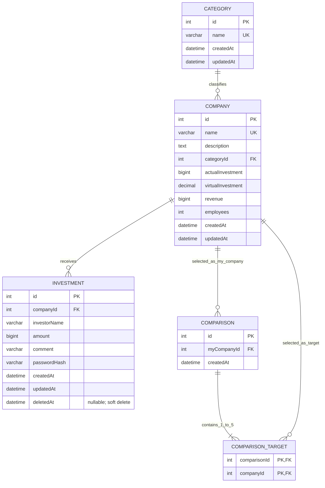

# View My Startup Database Design

## 설계 원칙

- PostgreSQL 18과 Prisma 7을 사용한다.
- DB 테이블과 컬럼 이름은 snake_case로 작성하고, Prisma 모델과 코드 필드는 camelCase로 작성한다. Prisma의 `@@map`과 `@map`으로 DB 이름에 매핑한다.
- 기업 데이터는 초기 데이터로 넣고 서비스에서는 조회만 한다.
- 실제 누적 투자 금액, 개별 가상 투자 금액과 매출은 원 단위 정수이며 PostgreSQL `BIGINT`로 저장한다.
- 기업별 가상 투자 합계는 PostgreSQL `DECIMAL(38, 0)`으로 저장하고, 투자 변경과 같은 트랜잭션에서 갱신한다.
- API로 금액을 보낼 때는 정밀도 손실을 막기 위해 원 단위의 10진수 JSON `string`으로 변환한다.
- 투자 비밀번호는 원문을 저장하지 않고 bcrypt 해시만 저장한다.
- 가상 투자 삭제는 물리 삭제하지 않고 `Investment.deletedAt`에 삭제 시각을 기록한다.
- 투자 목록, 페이지네이션 개수, 가상 투자 합계에는 `deletedAt IS NULL`인 투자만 포함한다.
- 선택 횟수를 중복 저장하지 않고 비교 완료 이력을 집계한다.
- Prisma 7의 데이터베이스 URL은 이후 구현할 Prisma config에서 관리하며 `schema.prisma`에는 넣지 않는다.

실제 누적 투자 금액·가상 투자 금액·매출·고용 인원의 음수 금지와 비교 대상 1~5개 규칙은 Prisma 스키마가 직접 표현하지 못하므로 시드·API 검증과 비교 생성 트랜잭션에서 보장한다. API 입력 금액은 숫자로만 구성된 문자열이어야 하며 PostgreSQL `BIGINT` 최댓값인 `9223372036854775807` 이하로 제한한다.

## 데이터베이스 환경 분리

| 환경 | 데이터베이스 | `DATABASE_URL` 위치 |
| --- | --- | --- |
| 개발 | 개발자별 로컬 PostgreSQL 18 | `backend/.env` |
| 배포 | Render PostgreSQL 18 | Render 환경 변수 |

- 개발 DB와 배포 DB는 물리적으로 분리하고 서로 다른 `DATABASE_URL`을 사용한다.
- 두 환경은 `backend/prisma/schema.prisma`와 저장소에 커밋된 마이그레이션 파일을 공통으로 사용한다.
- 개발 환경에서는 스키마 변경을 위한 새 마이그레이션을 생성하고 로컬 DB에 적용할 수 있다.
- 배포 환경에서는 이미 생성된 마이그레이션만 적용한다. 배포 환경에서 새 마이그레이션을 생성하지 않는다.
- 로컬 DB는 필요할 때 초기화할 수 있지만 Render DB는 초기화하지 않는다.
- 로컬 DB의 행을 Render DB로 직접 복사하지 않는다.
- 카테고리와 기업 초기 데이터는 두 환경에 적용한다.
- 개발용 가상 투자와 비교 이력은 로컬 DB에만 둘 수 있으며 Render DB 시드에는 포함하지 않는다.
- 연결 문자열과 비밀번호는 환경 변수로만 관리하며 문서, 소스 코드, 로그에 기록하지 않는다.
- 스테이징 DB는 사용하지 않는다.

## ERD



Mermaid 표기에서 `||`는 정확히 1개, `o{`는 0개 이상, `|{`는 1개 이상을 뜻한다. `Comparison`의 비교 대상 상한 5개는 데이터베이스 외래 키만으로 표현하지 않고 API 트랜잭션에서 검증한다.

## ASCII ERD (English)

```text
+-------------------+       1 required      0..N optional      +----------------------+
| CATEGORY          | ||------------------------------------o{ | COMPANY              |
|-------------------|             classifies                 |----------------------|
| PK id             |                                        | PK id                |
| UK name           |                                        | FK categoryId        |
| createdAt         |                                        | name                 |
| updatedAt         |                                        | description          |
+-------------------+                                        | actualInvestment     |
                                                             | revenue              |
                                                             | employees            |
                                                             | createdAt            |
                                                             | updatedAt            |
                                                             +----------------------+
                                                                       ||
                              +----------------------------------------+||+------------------------------+
                              |                                         |                               |
                    0..N o{   |                               0..N o{   |                     0..N o{   |
                              | receives                                | selected as my                | selected as target
                              v                                         v                               v
                    +----------------------+                  +----------------------+       +----------------------+
                    | INVESTMENT           |                  | COMPARISON           |       | COMPARISON_TARGET    |
                    |----------------------|                  |----------------------|       |----------------------|
                    | PK id                |                  | PK id                | ||--|{ | PK/FK comparisonId |
                    | FK companyId         |                  | FK myCompanyId       | 1 1..5| PK/FK companyId    |
                    | investorName         |                  | createdAt            |       +----------------------+
                    | amount               |                  +----------------------+
                    | comment              |
                    | passwordHash         |
                    | createdAt            |
                    | updatedAt            |
                    | deletedAt (optional) |
                    +----------------------+
```

`COMPARISON ||--|{ COMPARISON_TARGET`은 비교 완료 한 건에 비교 대상이 반드시 1개 이상 존재한다는 뜻이다. 애플리케이션 규칙으로 최대 5개까지 허용한다.

## 테이블 정의

### Category

| 열 | Prisma / PostgreSQL | NULL | 제약 | 설명 |
| --- | --- | --- | --- | --- |
| `id` | `Int` / `INTEGER` | 불가 | PK, 자동 증가 | 카테고리 식별자 |
| `name` | `String` / `VARCHAR(50)` | 불가 | UNIQUE | 카테고리 이름 |
| `createdAt` | `DateTime` / `TIMESTAMP` | 불가 | 기본값 현재 시각 | 생성 시각 |
| `updatedAt` | `DateTime` / `TIMESTAMP` | 불가 | 자동 갱신 | 수정 시각 |

### Company

| 열 | Prisma / PostgreSQL | NULL | 제약 | 설명 |
| --- | --- | --- | --- | --- |
| `id` | `Int` / `INTEGER` | 불가 | PK, 자동 증가 | 기업 식별자 |
| `name` | `String` / `VARCHAR(100)` | 불가 | UNIQUE | 기업명 |
| `description` | `String` / `TEXT` | 불가 |  | 기업 소개 |
| `categoryId` | `Int` / `INTEGER` | 불가 | FK → `Category.id`, RESTRICT | 카테고리 식별자 |
| `actualInvestment` | `BigInt` / `BIGINT` | 불가 | 인덱스 | 시드로 제공하는 실제 누적 투자 금액 |
| `virtualInvestment` | `Decimal` / `DECIMAL(38,0)` | 불가 | 기본값 `0` | 활성 가상 투자 합계. 투자 변경과 같은 트랜잭션에서 유지 |
| `revenue` | `BigInt` / `BIGINT` | 불가 | 인덱스 | 매출액 |
| `employees` | `Int` / `INTEGER` | 불가 | 인덱스 | 고용 인원 |
| `createdAt` | `DateTime` / `TIMESTAMP` | 불가 | 기본값 현재 시각 | 생성 시각 |
| `updatedAt` | `DateTime` / `TIMESTAMP` | 불가 | 자동 갱신 | 수정 시각 |

### Investment

| 열 | Prisma / PostgreSQL | NULL | 제약 | 설명 |
| --- | --- | --- | --- | --- |
| `id` | `Int` / `INTEGER` | 불가 | PK, 자동 증가 | 가상 투자 식별자 |
| `companyId` | `Int` / `INTEGER` | 불가 | FK → `Company.id`, RESTRICT | 투자 대상 기업 |
| `investorName` | `String` / `VARCHAR(20)` | 불가 |  | 투자자 이름 |
| `amount` | `BigInt` / `BIGINT` | 불가 |  | 투자 금액 |
| `comment` | `String` / `VARCHAR(200)` | 불가 |  | 투자 코멘트 |
| `passwordHash` | `String` / `VARCHAR(60)` | 불가 |  | bcrypt 해시 |
| `createdAt` | `DateTime` / `TIMESTAMP` | 불가 | 기본값 현재 시각 | 생성 시각 |
| `updatedAt` | `DateTime` / `TIMESTAMP` | 불가 | 자동 갱신 | 수정 시각 |
| `deletedAt` | `DateTime?` / `TIMESTAMP` | 허용 |  | `NULL`이면 활성, 값이 있으면 삭제됨 |

`(companyId, deletedAt, createdAt)` 복합 인덱스로 기업별 활성 투자 목록 조회를 지원한다.

### Comparison

| 열 | Prisma / PostgreSQL | NULL | 제약 | 설명 |
| --- | --- | --- | --- | --- |
| `id` | `Int` / `INTEGER` | 불가 | PK, 자동 증가 | 선택 완료 이력 식별자 |
| `myCompanyId` | `Int` / `INTEGER` | 불가 | FK → `Company.id`, RESTRICT | 내 기업으로 확정한 기업 |
| `createdAt` | `DateTime` / `TIMESTAMP` | 불가 | 기본값 현재 시각 | 선택 완료 시각 |

`Company`에 내 기업 선택 횟수를 저장하지 않고 `myCompanyId`별 행 개수를 집계한다.

### ComparisonTarget

| 열 | Prisma / PostgreSQL | NULL | 제약 | 설명 |
| --- | --- | --- | --- | --- |
| `comparisonId` | `Int` / `INTEGER` | 불가 | 복합 PK, FK → `Comparison.id`, CASCADE | 비교 완료 이력 |
| `companyId` | `Int` / `INTEGER` | 불가 | 복합 PK, FK → `Company.id`, RESTRICT | 비교 기업 |

복합 기본키가 같은 비교 완료 건 안에서 동일 기업의 중복 선택을 막는다. 비교 기업 선택 횟수는 `companyId`별 행 개수로 집계한다.

## 관계 차수와 선택 사양

| 관계 | 왼쪽에서 오른쪽 | 오른쪽에서 왼쪽 | 참여 조건 | 삭제 정책 |
| --- | --- | --- | --- | --- |
| Category — Company | Category 하나는 Company `0..N`개를 가질 수 있음 | Company 하나는 Category `1`개를 반드시 가짐 | Company 쪽 필수, Category 쪽 선택 | Category 삭제 RESTRICT |
| Company — Investment | Company 하나는 활성·삭제된 Investment `0..N`개를 가질 수 있음 | Investment 하나는 Company `1`개를 반드시 가짐 | Investment 쪽 필수, Company 쪽 선택 | Company 삭제 RESTRICT, Investment soft delete |
| Company — Comparison | Company 하나는 내 기업으로 Comparison `0..N`건에 선택될 수 있음 | Comparison 하나는 내 Company `1`개를 반드시 가짐 | Comparison 쪽 필수, Company 쪽 선택 | Company 삭제 RESTRICT |
| Comparison — ComparisonTarget | Comparison 하나는 ComparisonTarget `1..5`개를 반드시 가짐 | ComparisonTarget 하나는 Comparison `1`건에 반드시 속함 | 양쪽 필수 | Comparison 삭제 시 Target CASCADE |
| Company — ComparisonTarget | Company 하나는 비교 대상으로 ComparisonTarget `0..N`건에 선택될 수 있음 | ComparisonTarget 하나는 Company `1`개를 반드시 가리킴 | Target 쪽 필수, Company 쪽 선택 | Company 삭제 RESTRICT |

`Comparison`과 `ComparisonTarget` 생성은 하나의 데이터베이스 트랜잭션으로 처리한다. 비교 대상 1~5개, 중복 금지, 내 기업 제외 규칙을 모두 검증한 뒤 함께 저장하여 대상이 없는 비교 이력이 남지 않게 한다.

## 정규화

### 제1정규형(1NF)

- 모든 열은 원자값만 가진다.
- 비교 기업 ID 배열을 `Comparison` 한 열에 저장하지 않고 `ComparisonTarget`의 개별 행으로 분리한다.
- 기업의 투자 내역이나 카테고리 목록을 문자열로 합쳐 저장하지 않는다.

### 제2정규형(2NF)

- 단일 기본키를 가진 테이블의 일반 열은 각 기본키 전체에 종속된다.
- `ComparisonTarget`은 `(comparisonId, companyId)` 복합 기본키만 가지며 부분 종속되는 일반 열이 없다.

### 제3정규형(3NF)

- 카테고리 이름을 `Company`마다 반복하지 않고 `Category`로 분리한다.
- 기업 정보는 `Investment`, `Comparison`, `ComparisonTarget`에 중복 저장하지 않고 외래 키로 참조한다.
- 내 기업·비교 기업 선택 횟수를 `Company`에 중복 저장하지 않고 비교 이력에서 계산한다.
- 실제 누적 투자 금액은 `Company.actualInvestment`에 시드 데이터로 저장한다.
- 가상 투자 합계는 `Company.virtualInvestment`에 저장한다. 활성 투자(`deletedAt IS NULL`)의 `amount` 합계를 나타내며, 투자 등록·금액 수정·soft delete와 같은 트랜잭션에서 함께 갱신한다. 초기값은 마이그레이션에서 기존 활성 투자 행을 집계해 채운다.

## 파생 값과 집계

| 값 | 계산 기준 |
| --- | --- |
| 기업별 실제 누적 투자 금액 | `Company.actualInvestment` |
| 기업별 가상 투자 합계 | `Company.virtualInvestment`. 활성 `Investment.amount` 합계를 반영하며 활성 투자 내역이 없으면 `0` |
| 내 기업 선택 횟수 | `Comparison.myCompanyId`별 행 개수 |
| 비교 기업 선택 횟수 | `ComparisonTarget.companyId`별 행 개수 |
| 매출액·고용 인원 순위 | `Company.revenue` 또는 `Company.employees` 정렬 결과 |

`virtualInvestment`는 파생 값이지만 투자 현황 조회에서 전체 투자 행을 매번 합산할 때 트랜잭션 시간 초과가 발생해 `Company`에 비정규화하여 저장한다. 투자 변경과 합계 변경을 하나의 트랜잭션으로 처리하고, 기존 데이터는 마이그레이션에서 초기 집계한다. 선택 횟수는 계속 비교 이력에서 계산한다. `actualInvestment`는 외부에서 주어진 실제 투자 실적의 원본 값이므로 `Company`에 저장한다.

## Soft Delete 규칙

1. 투자 삭제 시 행을 삭제하지 않고 `deletedAt`에 현재 시각을 기록한다.
2. 기업별 투자 목록 조회와 페이지네이션 개수에는 `deletedAt IS NULL`인 투자만 포함한다.
3. 기업별 가상 투자 합계와 투자 현황의 가상 투자 금액 집계에는 `deletedAt IS NULL`인 투자만 포함한다.
4. 이미 삭제된 투자는 목록 조회와 개별 수정·삭제 대상에서 존재하지 않는 투자와 동일하게 처리한다.
5. 삭제된 투자도 비밀번호 해시를 포함한 원래 행을 보존하므로 운영 DB 접근 권한과 보존 기간은 별도 운영 정책으로 관리한다.

## 인덱스

| 테이블 | 인덱스 | 사용 목적 |
| --- | --- | --- |
| Category | `UNIQUE(name)` | 카테고리 중복 방지 |
| Company | `UNIQUE(name)` | 기업명 중복 방지와 검색 |
| Company | `INDEX(categoryId)` | 카테고리 관계 조회 |
| Company | `INDEX(actualInvestment)` | 실제 누적 투자 금액 정렬 |
| Company | `INDEX(virtualInvestment DESC, id ASC)` | 가상 투자 현황의 내림차순 정렬 및 동액 기업 ID 오름차순 표시 |
| Company | `INDEX(revenue)` | 매출액 정렬과 순위 계산 |
| Company | `INDEX(employees)` | 고용 인원 정렬과 순위 계산 |
| Investment | `INDEX(companyId, deletedAt, createdAt)` | 기업별 활성 투자 최신순 목록 조회 |
| Comparison | `INDEX(myCompanyId)` | 내 기업 선택 횟수 집계 |
| ComparisonTarget | `PRIMARY KEY(comparisonId, companyId)` | 대상 중복 방지와 비교별 대상 조회 |
| ComparisonTarget | `INDEX(companyId)` | 비교 기업 선택 횟수 집계 |
